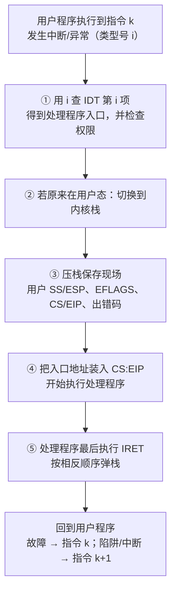

# 中断与异常 学习笔记

> 课程：计算机系统 · 主题：中断与异常（以 Intel IA-32 / Linux 为例）

## 目录

1. [可屏蔽中断 vs 不可屏蔽中断](#1-可屏蔽中断-vs-不可屏蔽中断)
2. [异常的三类：故障、陷阱、中止](#2-异常的三类故障陷阱中止)
3. [例子：printf 中的 int $0x80 是陷阱](#3-例子printf-中的-int-0x80-是陷阱)
4. [补充：什么是 OS](#4-补充什么是-os)
5. [关中断](#5-关中断)
6. [IA-32 中断/异常的响应与返回](#6-ia-32-中断异常的响应与返回)
7. [例题：INT_MIN / -1 为什么结果不同](#7-例题int_min---1-为什么结果不同)
8. [易混点汇总](#8-易混点汇总)

---

## 1. 可屏蔽中断 vs 不可屏蔽中断

核心区别：**CPU 能不能选择"暂时不理它"**。

| | 可屏蔽中断（INTR） | 不可屏蔽中断（NMI） |
|---|---|---|
| 请求引脚 | INTR | NMI |
| 受 IF 控制？ | 受。`CLI` 令 IF=0 后不响应，`STI` 令 IF=1 后恢复 | **不受**，`CLI` 了照样响应 |
| 还能怎么屏蔽 | 中断控制器（如 8259A）的**屏蔽字**，可单独屏蔽某一路设备 | 无法屏蔽 |
| 典型来源 | 键盘、鼠标、时钟等 I/O 设备 | 掉电、存储器出错、总线奇偶校验错等致命硬件故障 |
| 特点 | 晚点处理也没事 | 非常紧急，必须立刻处理（保存关键信息、报错或重启） |

**比喻**：可屏蔽中断像手机来电，开了勿扰模式可以先不接；不可屏蔽中断像火警警报，没法静音。

### 中断源的整体分类

```
中断源
├── 外部中断（"中断"，随机发生，与当前指令无关）
│   ├── 不可屏蔽中断 NMI：电源掉电、存储器出错、总线奇偶校验错
│   └── 可屏蔽中断 INTR：键盘、鼠标、时钟……
│         开中断状态（STI，IF=1）/ 关中断状态（CLI，IF=0）
└── 内部中断（"异常"，与 CPU 状态和当前执行的指令有关）
    ├── CPU 检测：除法出错、单步中断、协处理器段超越等
    └── 程序检测：软中断，如 INTO、INT n、BOUND 等
```

> ⚠️ IF 只管**外部的可屏蔽中断**。内部异常（除零、单步、`INT n` 等）由指令本身产生，也不受 IF 影响。

---

## 2. 异常的三类：故障、陷阱、中止

根本区别：**异常在指令执行的哪个时刻报告**，由此决定**处理完返回到哪里**。

| 类型 | 报告时机 | 保存的返回地址（EIP） | 处理后 | 典型例子 |
|---|---|---|---|---|
| 故障 fault | 指令**执行完成之前**（指令"没做成"） | 指向**出错的那条指令** | **重新执行**该指令 | 缺页、除法错 #DE |
| 陷阱 trap | 指令**执行完成之后**（指令已正常做完） | 指向**下一条指令** | 接着往下执行 | `INT n`（系统调用）、`INT 3` 断点、单步调试、`INTO` |
| 中止 abort | 严重硬件错误 | 无法保证准确 | **终止程序** | 硬件严重故障 |

另外：**中断**处理完后也是返回到被打断处的下一条指令继续执行。

**记忆口诀**：

- 故障：出了问题，**修好再试一次**（如缺页：OS 把页面调入内存，回来重新访问，对程序透明）
- 陷阱：做完了，**叫一声再继续**（通常是程序有意触发，主动请 OS / 调试器介入）
- 中止：没救了，**直接结束**

---

## 3. 例子：printf 中的 int $0x80 是陷阱

Linux 中 `printf()` 的调用链：

```
用户态（用户空间）                                   内核态（内核空间）
main()  →  printf()  →  write()  ──int $0x80──→  system_call()  →  sys_write()
用户程序   I/O 标准库函数  系统调用封装函数              系统调用处理程序      系统调用服务例程
```

- `main → printf → write` 都只是用户态的**普通函数调用**，不涉及异常。
- 真正触发异常的是 `write()` 里的 **`int $0x80`** 指令。

它是**陷阱**，原因：

1. **有意的**：程序故意执行它，目的是"陷入"内核，请 OS 完成写操作，不是出错。
2. **返回下一条**：保存的返回地址指向 `int $0x80` 的下一条指令。若像故障那样返回到 `int $0x80` 本身，就会无限重复调用 write。

> "陷入内核"（trap into kernel）的说法就来源于此。
> 补充：`int $0x80` 是 32 位 Linux 的老方式，x86-64 上一般用专门的 `syscall` 指令，更快，思路相同。

---

## 4. 补充：什么是 OS

**OS = Operating System，操作系统**（Windows、Linux、macOS、Android……），是管理整台计算机的"大管家"程序，位于硬件和普通程序之间：

- **管硬件**：CPU、内存、硬盘、显示器、键盘等资源由它统一分配和控制。
- **为程序提供服务**：用户程序不能直接操作硬件，输出到屏幕、读写文件都要请 OS 代办，方式就是**系统调用**。

相关概念：

- **内核（kernel）**：OS 的核心部分，运行在**内核态**，如 `system_call()`、`sys_write()`。
- **用户态**：普通程序（如 `main`、`printf`）运行的状态，权限受限，不能直接访问硬件。
- 中断 / 异常发生后跳去执行的处理程序，都由 OS 内核提供。

---

## 5. 关中断

**关中断**：把 CPU 中的**中断允许位 IF 清 0**（即 `CLI` 的效果），使 CPU 暂时**不响应新的可屏蔽中断**。

### CPU 检测到异常或中断时的基本处理

1. **关中断**（IF 清 0）：防止新中断破坏断点（PC）、程序状态（PSW）和现场（通用寄存器）。
2. **保护断点和程序状态**：保存到栈或特殊寄存器。
   - PC → 栈 或 EPC（专门存放断点的寄存器）
   - PSWR → 栈 或 EPSWR（专门保存程序状态的寄存器）
   - PSW = Program Status Word，程序状态字；PSWR 如 IA-32 中的 EFLAGS 寄存器
3. **识别中断事件**：软件识别或硬件识别（向量中断）。

### 为什么第一步要关中断？

第 2 步保存的断点和程序状态是将来"回到原处"的唯一凭据。如果保存到一半又来了新中断：

- 若用 EPC 这类**专用寄存器**，新的断点会**覆盖**旧的，原程序的返回地址就丢了；
- 即使存在栈里，保存过程被打断也可能留下不完整的现场。

所以要先关中断，保证"保存现场"一口气做完。现场保存好后，处理程序可按需再开中断，允许更高优先级的中断嵌套。

### 补充

- 关中断只能挡住**可屏蔽中断**，NMI 照样进来。
- **IA-32 中，响应异常时不关中断，只在响应中断时关中断。** 异常由当前指令引起，处理期间被外部中断打断并不危险（IA-32 用栈保存断点，不存在被覆盖的问题），不关中断能让外设请求得到更及时的响应。

---

## 6. IA-32 中断/异常的响应与返回

### 一句话主线

**查表找处理程序 → 检查权限 → 切到内核栈 → 保存返回地址和状态 → 跳过去执行 → IRET 原路恢复**

### 流程图



### 响应（去）：简化版

1. **查表找处理程序**：每种中断/异常有一个类型号 i，CPU 到 **IDT（中断描述符表）** 中取第 i 项，得到处理程序的入口地址。
2. **检查权限**：防止用户程序随便写一条 `INT n` 跳进内核乱搞，不合法则触发 13 号异常。
3. **换栈**：若原来在用户态，切换到内核栈，并把原来用户栈的 SS、ESP 存进内核栈。
4. **保存回来的路**：把 EFLAGS（程序状态）、CS:EIP（断点）压栈；若有硬件出错码也压栈。
   - 故障：EIP 指向出错指令本身
   - 其他：EIP 指向下一条指令
5. **跳过去执行**：把 IDT 表项中的入口地址装入 CS:EIP，下个时钟周期开始执行处理程序。

### 内核栈中保存的内容（自高地址向低地址压入）

| 压栈顺序 | 内容 | 说明 |
|---|---|---|
| 1 | 用户 SS | 仅从用户态进入时 |
| 2 | 用户 ESP | 仅从用户态进入时 |
| 3 | EFLAGS | 程序状态 |
| 4 | CS | 断点（段） |
| 5 | EIP | 断点（返回地址） |
| 6 | 出错码 | 若有，此时位于栈顶 |

### 返回（回）：IRET

处理程序最后一条指令是 **IRET**，基本就是把响应过程倒过来：

1. 从栈中弹出出错码（若有）、EIP、CS、EFLAGS，回到断点；
2. 若当初是从用户态进入的，再弹出 SS、ESP，切回用户栈；
3. 清理 DS、ES、FS、GS 中指向内核段的段寄存器，防止用户程序借内核用过的段访问内核空间。

执行完 IRET 后，CPU 回到原来的进程继续执行，原程序感觉不到中间发生过什么。

> **栈就像一张"回程票"**：进去时存，出来时取，存取顺序正好相反。
>
> DPL、CPL、TSS、GDT 等细节留到学保护模式和操作系统时再深入。

---

## 7. 例题：INT_MIN / -1 为什么结果不同

### 题目

**代码段一：**

```c
int a = 0x80000000;
int b = a / -1;
printf("%d\n", b);
```

运行结果：`-2147483648`

**代码段二：**

```c
int a = 0x80000000;
int b = -1;
int c = a / b;
printf("%d\n", c);
```

运行结果：`Floating point exception`（程序崩溃）

### 第一步：这道题的答案本来就装不下

- int 的范围：−2147483648 ~ +2147483647
- `0x80000000` = −2147483648（即 `INT_MIN`）
- −2147483648 ÷ (−1) = **+2147483648**，比最大值还多 1，**必然溢出**

### 第二步：同样的 `a / -1`，被编译器翻译成了不同的指令

| | 代码段一 | 代码段二 |
|---|---|---|
| 除数 | 常量 `-1`，编译时就知道 | 变量 `b`，编译器不追踪它的值 |
| 编译器生成的指令 | `neg`（取负，即取反加一） | `idiv`（有符号除法） |
| 原因 | "除以 −1"与"变号"等价，`neg` 约 1 个周期，除法要几十个周期，于是**编译优化**为 `neg` | 只能按一般情况翻译成除法 |

> 关键：发现 −1 的是**编译器**，而且是在**程序运行之前**。代码段一编译出的程序里**根本没有除法指令**。

### 第三步：两条指令遇到"装不下"时的反应不同

- **`neg`（与加减法同类）**：溢出时只把 **OF 标志位**置 1，**不报异常**。对 0x80000000 取反得 0x7FFFFFFF，加一又回到 0x80000000，程序继续执行，打印出错误结果 −2147483648。
- **`idiv`**：Intel 规定**商放不进目标寄存器就触发 0 号异常 #DE（除法错）**，和除以 0 是同一个异常。

### 为什么除法要报异常，加减法不报？

- **加减、取负溢出**：截掉高位后剩下的低 32 位**仍然有用**（大数分段运算、无符号数运算等）。硬件照常给出结果，只置 OF 提醒，由程序自己决定要不要检查。
- **除法溢出**：除以 0 根本没有结果；商太大时截断后的结果**毫无意义**。
  - 例：`idiv` 实际是用 64 位数（EDX:EAX）除以 32 位数，商必须放进 32 位的 EAX。拿一个很大的 64 位数除以 1，商就是它本身，截断后与正确答案毫无关系。
  - 交不出像样的结果，CPU 干脆报异常，交给 OS 处理。

### 代码段二的完整过程

```
idiv 发现商溢出
  → 触发 #DE（类型 0，属于故障）
  → 查 IDT 第 0 项，进入内核的处理程序
  → Linux 向进程发送 SIGFPE 信号
  → 默认动作：终止进程
  → shell 打印 "Floating point exception"
```

- "Floating point exception" 是历史遗留的名字，**和浮点数无关**。
- #DE 是**故障**，返回地址指向 `idiv` 本身。若处理程序直接返回，会重新执行 `idiv` 再次出错，陷入死循环，所以 OS 只能终止进程。

### 延伸

- 若代码段二用较高优化级别（如 `-O2`）编译，编译器可能推断出 `b` 就是 −1，同样换成 `neg`，那么代码段二也会默默打印 −2147483648。**结果不同的根源在于编译器最终生成了什么指令。**
- C 标准规定 `INT_MIN / -1` 是**未定义行为（UB）**，编译器怎么处理都不算错。

### 比喻

同一笔算不了的账交给两个会计：`neg` 算错了不吭声，直接交了个错数；`idiv` 发现不对劲马上拉警报，老板（OS）把这单业务叫停了。

---

## 8. 易混点汇总

| 易混点 | 结论 |
|---|---|
| IF 管什么 | 只管**外部可屏蔽中断**；NMI 和内部异常都不受影响 |
| 故障 vs 陷阱 | 故障返回**出错指令**重做；陷阱返回**下一条**指令 |
| `int $0x80` 属于什么 | **陷阱**（有意触发的软中断，返回下一条指令） |
| 除法错 #DE 属于什么 | **故障**（EIP 指向 `idiv` 本身） |
| IA-32 何时关中断 | 响应**中断**时关，响应**异常**时不关 |
| 加减溢出会触发异常吗 | **不会**，只置 OF 标志 |
| 除法溢出会触发异常吗 | **会**，触发 #DE（与除以 0 相同） |
| 代码段一为什么不报警 | 编译器把 `/ -1` 优化成了 `neg`，运行时根本没有除法 |
