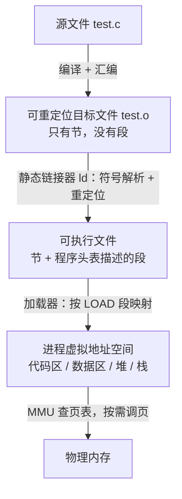
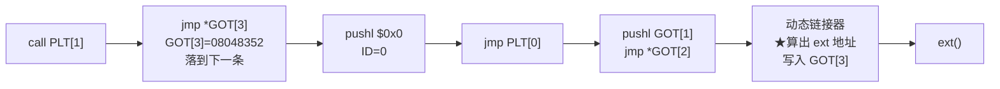

# 链接与加载 学习笔记

> 计算机系统课程「链接」一章的学习笔记，平台为 IA-32 / ELF / Linux。
> 内容按"问题 → 解答"整理，例题均来自课件。流程图使用 Mermaid，GitHub 会自动渲染。

**目录**

0. 全景：从源文件到内存
1. 虚拟地址
2. 可重定位目标文件（.o）的结构
3. 可执行文件与加载
4. 符号与符号解析
5. 静态库与 E、U、D 过程
6. 重定位（R_386_PC32 / R_386_32）
7. 共享库与动态链接
8. 位置无关代码（PIC）：GOT 与 PLT
9. 易错点速查

---

## 0. 全景：从源文件到内存



- **节**（section）是 .o 里的划分，给**链接器**看。
- **段**（segment）是链接后把权限相同的节合并成的块，给**加载器**看。
- 加载器按 LOAD 段把文件映射到**虚拟地址**；真正放进物理内存的哪里，由操作系统通过页表决定。

---

## 1. 虚拟地址

**虚拟地址**是程序"以为"自己在用的地址，不是内存条上的真实位置。

- 操作系统给**每个进程**一个独立、完整的地址空间，程序里的指针、跳转目标、变量地址都是虚拟地址。
- CPU 访问内存时，硬件 **MMU** 查**页表**，把虚拟地址翻译成**物理地址**，以**页**（通常 4KB）为单位。

```
程序用的地址 0x08048000 ──(MMU 查页表)──> 物理内存某处
```

类比：每栋楼都可以有"101 室"，不会冲突，因为在不同的楼里；操作系统像物业，知道每个"101"实际在哪。

**和链接的关系**：链接器敢在链接时就把地址定死（例如 IA-32 Linux 代码段从 `0x08048000` 开始），正是因为每个进程都有自己的虚拟地址空间，所有程序都可以用同一个起始地址，互不冲突。

**好处**：简化链接和加载；进程隔离；内存保护（页表权限位，如写只读页会段错误）；不常用的页可以换到磁盘上。

---

## 2. 可重定位目标文件（.o）的结构

### 2.1 各个节

| 节 | 内容 | 运行时装入内存？ |
|---|---|---|
| ELF 头 | 描述整个文件的结构 | — |
| `.text` | 机器指令 | ✅ |
| `.rodata` | 只读数据：字符串字面量、`const` 全局变量、switch 跳转表 | ✅（只读） |
| `.data` | **已初始化**的全局变量和静态变量 | ✅ |
| `.bss` | **未初始化**（或初始化为 0）的全局变量和静态变量 | ✅（加载时分配并清零） |
| `.symtab` | 符号表：定义和引用了哪些函数、全局变量 | ❌ 给链接器用 |
| `.rel.text` | 代码中哪些位置的地址需要重定位 | ❌ 给链接器用 |
| `.rel.data` | 数据中哪些位置的地址需要重定位（如全局指针的初值是别的变量的地址） | ❌ 给链接器用 |
| `.debug` / `.line` | 调试信息（`gcc -g` 才有）；`.line` 是指令和源码行号的对应关系 | ❌ 给调试器用 |
| `.strtab` | 字符串表：符号名、节名 | ❌ |
| 节头表 | 每个节的位置、大小等 | ❌ |

> 课件上的 "`.rel.txt`" 应为 `.rel.text`。

### 2.2 作用域 vs 存储期

"全局 / 局部"说的是**作用域**（谁能看见）；放在 `.data`/`.bss` 还是栈上，看的是**存储期**（活多久）。

| | 静态存储（.data / .bss） | 自动存储（栈） |
|---|---|---|
| 生命周期 | 整个程序运行期间，只有一份 | 函数调用时出现，返回就消失；递归时可能同时有多份 |
| 地址何时确定 | **链接时**就分配固定的虚拟地址 | **运行时**，相对栈指针访问 |
| 在 ELF 文件里吗 | 在 | **不在**，栈由操作系统在启动时划出 |

```c
int x = 100;          // 全局，.data
int y;                // 全局，未初始化，.bss
void f() {
    static int a = 1; // 作用域是局部的，但放在 .data！决定位置的是 static
    int i;            // 局部变量，栈上
}
```

在汇编里能直接看出区别：

```asm
mov  0x601040, %eax      # 读全局变量：固定地址（链接时由重定位填好）
mov  -0x4(%rbp), %eax    # 读局部变量：栈帧基址往下 4 字节
```

进程虚拟地址空间的布局：

```
高地址  ┌──────────────┐
        │      栈      │ ← 局部变量，运行时增长/收缩（向低地址增长）
        │       ↓      │
        │       ↑      │
        │      堆      │ ← malloc
        ├──────────────┤
        │     .bss     │ ← 加载时清零
        │     .data    │ ← 从 ELF 文件复制初值
        │ .text/.rodata│ ← 指令、只读数据
低地址  └──────────────┘
```

### 2.3 `char *s` 和 `char s[]` 为什么不一样

```c
char *p = "hello";   // p 是指针（8 字节），指向 .rodata 里的 "hello"
char  a[] = "hello"; // a 是数组（6 字节），"hello" 只是用来初始化它的值
```

```
p 的情况：  栈: p [0x402010] ──→ .rodata: 'h' 'e' 'l' 'l' 'o' '\0'   ← 只读
a 的情况：  栈: a ['h' 'e' 'l' 'l' 'o' '\0']                          ← 自己的一份，可写
```

| | `char *p = "hello"` | `char a[] = "hello"` |
|---|---|---|
| `sizeof` | 8（指针大小） | 6（整个数组） |
| `p[0] = 'H'` / `a[0] = 'H'` | **段错误**（写只读页） | 可以 |
| `p = "world"` / `a = "world"` | 可以 | 编译错误（数组名不能赋值） |

**字符串字面量为什么放在 .rodata、只有一份？**

1. **要一直存在**：C 规定字面量具有静态存储期，生命周期是整个程序，所以不能放栈上（否则函数返回后指针就悬空了）。
2. **不准修改**：C 规定修改字面量是未定义行为，所以编译器放心地把它放进只读的 .rodata，并且可以把多个相同的 `"hello"` **合并成同一份**（`p == q` 在 gcc 下通常为真）。正因为只读，才能放心共享。

> "字符串"指的是 `"hello"` 这 6 个字节，不是指针。指针只是"指向一个字符串"。
> 一句话：**指针是"记住别人在哪"，数组是"自己就是那块内存"。**

### 2.4 .bss 为什么不占文件空间却有大小

`.bss` 里的变量初值**全是 0**，没必要在文件里真的存一堆 0，只需要在节头表里记一句"运行时需要多少字节"。加载时再分配并清零。

类比：`.data` 是把货物（初值）实际寄过去；`.bss` 是只寄一张纸条"到了给我准备 12 个空箱子"。

所以 `int buf[1000000];` 放在 `.bss`，可执行文件不会因此变大 4MB。

### 2.5 节头表：Off 和 Size（`readelf -S test.o`）

- **Off**：这个节在文件中**从第几个字节开始**。
- **Size**：这个节**真正有用的内容有多少字节**（不含填充）。

**Off + Size = 节结束的位置**；相邻两节的 Off 之差 = Size + 后面的填充，所以一般 **Off 差 ≥ Size**。

例（课件数据）：

| 节 | Off | Size | 说明 |
|---|---|---|---|
| .text | 0x34 | 0x5b | 结束于 0x8f |
| .data | 0x90 | 0x0c | Al = 4，起点要 4 字节对齐，0x8f → 0x90，空了 1 字节 |
| .bss | 0x9c | 0x0c | 文件里不占空间，所以 Off 和 .rodata 相同 |
| .rodata | 0x9c | 0x04 | 0x9c + 4 = 0xa0，正好是下一节起点 |

另外，**节头表里的顺序 ≠ 文件中的顺序**，要按 Off 排序才是真实布局。

---

## 3. 可执行文件与加载

### 3.1 ELF 头（`readelf -h main`）

`readelf -h` 输出的整段都是 **ELF 头**，只有 52 字节（第 0～51 字节）。它里面记录了另外两张表的位置：

| ELF 头中的字段 | 指向 | 由此算出的位置 |
|---|---|---|
| Start of program headers: 52，Size: 32，Number: 8 | 程序头表 | 第 52～307 字节（8 × 32 = 256） |
| Start of section headers: 3232，Size: 40，Number: 29 | 节头表 | 第 3232 字节起，共 29 × 40 = 1160 字节 |

### 3.2 程序头表与可装入段（`readelf -l main`）

**程序头表**是写给**加载器**的"装载说明书"，每项描述一个**段**。Type = **LOAD** 的项就是**可装入段**，每项相当于一条指令：

> 把文件中从 **Offset** 开始的 **FileSiz** 个字节，映射到虚拟地址 **VirtAddr**，在内存中占 **MemSiz** 字节，权限是 **Flg**。

课件例子（8 个表项，其中 2 个 LOAD）：

| | Offset | VirtAddr | FileSiz | MemSiz | Flg | 内容 |
|---|---|---|---|---|---|---|
| 第一个 LOAD | 0x000000 | 0x08048000 | 0x4d4 | 0x4d4 | R E | 只读代码段：ELF 头、程序头表、.init、.text、.rodata |
| 第二个 LOAD | 0x000f0c | 0x08049f0c | 0x108 | 0x110 | RW | 可读写数据段：.data（264B）+ .bss（多出的 8B，清零） |

- **Align = 0x1000（4KB）**：映射以页为单位，段的文件偏移和虚拟地址要模 4KB 同余。
- **FileSiz < MemSiz**：多出来的部分就是 .bss。
- INTERP 项写着动态链接器的路径 `/lib/ld-linux.so.2`。

### 3.3 段 vs 节

| | 节头表 | 程序头表 |
|---|---|---|
| 给谁看 | 链接器 | 加载器 |
| 描述什么 | 每个节 | 每个段（几个权限相同的节合在一起） |
| 谁有 | .o 和可执行文件都有 | **只有可执行文件** |

- 段**不是文件**，是可执行文件里的一块区域。
- `.symtab`、`.debug` 等不属于任何 LOAD 段，不会被装入内存。
- 加载与重定位是两个阶段：重定位在**链接时**完成；到加载时地址都已填好，加载器只管整块搬。

### 3.4 装入 ≠ 立刻放进物理内存

加载器只是在进程虚拟地址空间里划出区域，并在页表里记下"这段对应文件的哪部分"。程序第一次访问某页时触发**缺页异常**，操作系统才分配物理页、从文件读入 —— **按需调页**。表中的 PhysAddr 在 Linux 上基本被忽略。

---

## 4. 符号与符号解析

### 4.1 为什么要有"已定义 / 未定义"

出发点是**分离编译**：每个 .c 单独编译成 .o，编译器一次只看得见一个文件。

```c
// main.c
extern int count;
void myfunc1(void);
int main() { myfunc1(); count = 5; printf("hi\n"); return 0; }
```

编译 main.c 时，编译器不知道 `myfunc1` 在哪，只能先把 call 的地址空着，并记两笔：

- 在 `.symtab` 里记：引用了符号 `myfunc1`，类型"未定义"。
- 在 `.rel.text` 里记：.text 第几个字节的地址，找到 myfunc1 后要填进去。

`nm main.o`：

```
00000000 T main       ← T：在 .text 中定义
         U myfunc1    ← U：引用了但没定义
         U count
         U printf
```

**链接器的工作就是"未定义去找已定义"：**

1. **符号解析**：给每个引用找到唯一的定义。找不到 → `undefined reference`；找到两个强定义 → `multiple definition`。
2. **重定位**：合并模块、确定地址后，把当初空着的地方填上。

类比：几个人分章节写书，第一章写"详见'快速排序'一节"，不知道在第几页，先留个记号；排版的人（链接器）合并后再把记号改成"详见第 87 页"。

> `extern int buf[];` 是**声明**不是**定义**：它让**编译**能通过，但存储空间不在本文件，所以在本 .o 的符号表里 buf 是 **UND**（未定义）。真正找到它是**链接**的事。
> 局部变量（如函数里的 `int temp`）不进符号表。

### 4.2 强符号、弱符号、本地符号

强弱之分只针对**本文件定义的全局符号**：

| 类型 | 例子 | 说明 |
|---|---|---|
| 强符号 | 函数；已初始化的全局变量（`int x = 1;`） | |
| 弱符号 | 未初始化的全局变量（`int y;`） | |
| 本地符号 | `static int *bufp1;` | 只在本文件可见，不会和别人冲突，**无强弱** |
| 外部符号引用 | `extern void swap();` | 只是引用，不是定义，**无强弱** |
| 不是符号 | 局部变量 `int temp;` | 在栈上，不进符号表 |

规则：多个强定义 → 报错；一强多弱 → 选强的；全是弱 → 任选一个。

> 注意：函数里的 `bufp1 = &buf[1];` 是运行时的赋值，不是初始化，所以它不影响 bufp1 "未初始化"的身份。

### 4.3 例题：d 变成 0，x 变成 1072693248

```c
// main.c                     // p1.c
int d = 100;                  double d;          // 弱符号
int x = 200;                  void p1() { d = 1.0; }
int main() { p1(); printf("d=%d,x=%d\n", d, x); }
```

结果：`d = 0`，`x = 1072693248`。

**根本原因：链接器只认名字，不认类型。**

1. **链接时**：main.c 的 `int d` 是强符号，p1.c 的 `double d` 是弱符号，选强的。整个程序只有一个 d，是 int，只占 **4 字节**，后面紧挨着 x。
2. **编译 p1.c 时**：编译器以为 d 是 double，`d = 1.0` 生成的是"往 &d 写 **8 字节**"。
3. **运行时**：多出的 4 字节覆盖了紧挨着的 x。

**数值怎么来的**：1.0 的 IEEE 754 双精度表示：

```
符号 0 | 阶码 1023 = 011 1111 1111 | 尾数 52 个 0（开头的 1 隐含）
= 3FF0 0000 0000 0000H
```

IA-32 是**小端**（低位字节放低地址）：

```
地址:   &d（4 字节）     &x（4 字节）
内容:   00 00 00 00     00 00 F0 3F
```

- d 读到 `0x00000000` = **0**
- x 读到 `0x3FF00000` = 0x40000000 − 0x00100000 = **1072693248**

补充：

- d 和 x 是全局变量，在 **.data** 里按定义顺序从低地址往高地址排，**和栈的增长方向无关**。
- d 变 0 只要类型不一致就会发生；x 被改坏是因为它**恰好**紧挨着 d。排布由编译器和链接器决定，所以这类 bug 后果不可预测。
- 避免方法：全局变量只在一个文件定义，其他文件用 `extern` 声明并放在同一个头文件里；`gcc -fno-common`（gcc 10 起默认）会让重复定义直接报错。

---

## 5. 静态库与 E、U、D 过程

### 5.1 创建和使用静态库

静态库（`.a`）就是**一堆 .o 打包**的归档文件。

```bash
gcc -c myproc1.c myproc2.c            # 得到 myproc1.o、myproc2.o
ar rcs mylib.a myproc1.o myproc2.o    # r 加入，c 不存在就创建，s 生成索引
gcc -c main.c
gcc -static -o myproc main.o ./mylib.a
```

调用关系：`main → myfunc1 → printf`。链接器**只取用到的成员**：myproc1.o 被取出，myproc2.o 没人引用，不进入 myproc；printf 在 libc.a 里，gcc 默认加上。

### 5.2 符号解析：E、U、D 三个集合

E、U、D 是链接器符号解析时**自己内部记账用的三张清单**，不是文件，链接结束就扔掉：

- **E**：装的是**文件**（.o），即最后要合并进可执行文件的目标模块。
- **U**：装的是**名字**，即被引用了、但还没找到定义的符号。
- **D**：装的是**名字**，即已经找到定义的符号。

规则：从左往右扫描命令行。扫到 .o 直接加入 E；扫到库时，**只取出能解决 U 中符号的模块**加入 E。每加入一个模块，它定义的符号进 D，它引用的新符号进 U。最后 U 为空则成功，然后合并 E 中的模块并重定位。

| 步骤 | 扫描对象 | E | U | D |
|---|---|---|---|---|
| 1 | — | 空 | 空 | 空 |
| 2 | main.o | main.o | myfunc1 | main |
| 3 | mylib.a → myproc1.o | main.o, myproc1.o | ~~myfunc1~~, printf | main, myfunc1 |
| 4 | mylib.a → myproc2.o | 不变（myproc2.o 被丢弃） | printf | main, myfunc1 |
| 5 | libc.a → printf.o 及其依赖 | + printf.o 等 | ~~printf~~ | + printf 等 |
| 6 | 合并输出 | 合并 E 中模块 → myproc | 空 ✅ | |

> **printf.o 及其依赖模块**：printf.o 是 libc.a 里一个完整的 .o（自己也有 .text、.symtab 等）；printf 内部又调用 vfprintf、write 等，它们在 libc.a 的其他 .o 里，也会被拉进来。

### 5.3 命令行中库的顺序

链接器**从左往右只扫一遍**，扫过的库不会回头。规则：**谁引用了某个库里的函数，谁就要写在这个库的前面。**

- `func.o → libx.a、liby.a`，`libx.a → libz.a`：
  `gcc -static -o myfunc func.o libx.a libz.a liby.a` 等都可以，只要 libx、liby 在 func.o 之后，libz 在 libx 之后。
  反例：`func.o libz.a libx.a` 会报 `undefined reference`。
- **互相依赖**（`libx.a ↔ liby.a`）：把库再写一次
  `gcc -static -o myfunc func.o libx.a liby.a libx.a`，
  或者用 `-Wl,--start-group libx.a liby.a -Wl,--end-group`。

---

## 6. 重定位

重定位就是：**编译器留空并写"待办条"（.rel.text / .rel.data），链接器确定所有地址后按待办条把空填上。**

重定位条目有三项：`r_offset`（要改的位置）、`r_sym`（填谁的地址）、`r_type`（怎么填）。

链接器**按节合并**：各 .o 中同名的节拼在一起，顺序一般同命令行。

```
.text: [ main.o 的 .text ][ swap.o 的 .text ]
       0x8048380          0x8048394
.data: [ main.o 的 .data ][ swap.o 的 .data ]   ← 另放一处
```

### 6.1 R_386_PC32：main 调用 swap

main.o 里 `swap();` 编译成：

```
6:  e8 fc ff ff ff     call ...         ← 后 4 字节先填占位值 −4
b:  b8 00 00 00 00     mov $0x0,%eax

.rel.text: r_offset = 0x7, r_sym = 10 (swap), r_type = R_386_PC32
```

```
偏移:  6    7    8    9    a  |  b
字节:  e8   fc   ff   ff   ff |  b8 ...
     操作码 └─ 4 字节偏移量 ─┘   下一条指令
```

**为什么是第 7 字节**：call 从第 6 字节开始，`e8` 是操作码不用改；要填的 4 字节偏移量从第 7 字节开始。

**CPU 执行 call 的规则**：CPU 先读完整条指令，PC 已经指向下一条，所以

```
目标 = 下一条指令地址 + 偏移量 = (第 7 字节的地址 + 4) + 偏移量
```

偏移量是 32 位整数，固定占第 7～a 字节，call 到此结束，所以下一条指令 = 第 7 字节 + 4。

**为什么是 −4**：重定位公式只算"符号地址 − 引用处地址"，但 CPU 从第 b 字节（= 第 7 字节 + 4）开始跳，多了 4，所以编译器预先在那里放 −4，让链接器顺手加上。`fc ff ff ff` 就是 −4 的补码 0xFFFFFFFC 按小端存放。

**计算**（设 main 在 0x8048380，课件例子的假设值）：

- main 的 .text 占 0x12 字节 → 结束于 0x8048392；swap.o 的 .text 要求 4 字节对齐 → **swap 在 0x8048394**
- 第 7 字节地址 = 0x8048387，下一条指令 = 0x804838b

```
新值 = swap 地址 − 引用处地址 + 原值
    = 0x8048394 − 0x8048387 + (−4) = 0xd − 4 = 0x9

链接前：e8 fc ff ff ff   ← −4，占位值 + 修正量
链接后：e8 09 00 00 00   ← 9，真正的偏移量
```

验证：PC = 0x804838b，加 9 = 0x8048394，正好是 swap。−4 只是计算用的原料，算出 9 后被覆盖。

### 6.2 R_386_32：.data 中的 bufp0

```c
// main.c                   // swap.c
int buf[2] = {1, 2};        extern int buf[];
                            int *bufp0 = &buf[0];
                            static int *bufp1;
                            void swap() {
                                int temp;
                                bufp1 = &buf[1];
                                temp = *bufp0;
                                *bufp0 = *bufp1;
                                *bufp1 = temp;
                            }
```

- main.o 的 `.data` 里 buf 存的是 `01 00 00 00 02 00 00 00`，普通数值，**不需要重定位**。
- swap.o 的 `.data` 里 bufp0 的初值是 buf 的**地址**，编译时不知道，先填 0，并在 `.rel.data` 记：`r_offset = 0x0, r_sym = 9 (buf), r_type = R_386_32`。
- swap.o 符号表第 9 项 buf 的 **Ndx = UND**（只引用、没定义）。

设合并后 buf 在 **0x08049620**、bufp0 在 **0x08049628**（buf 占 8 字节，bufp0 紧随其后）：

```
bufp0 的值 = buf 地址 + 0 = 0x08049620 → 小端 20 96 04 08
```

### 6.3 R_386_32：swap 函数里的 6 处

规律：**指令里只要出现全局/静态变量的地址，那 4 个字节就要重定位**；位置 = **指令起点 + 操作码长度**（`a1` 1 字节，`8b 15`、`c7 05` 2 字节）。

```
 6: c7 05 [00 00 00 00] [04 00 00 00]  movl $0x4,0x0      ← bufp1 = &buf[1]
10: a1 [00 00 00 00]                   mov  0x0,%eax      ← 读 bufp0
15: 8b 00                              mov  (%eax),%eax   ← *bufp0
17: 89 45 fc                           mov  %eax,-0x4(%ebp)  ← temp（局部变量，不用重定位）
1a: a1 [00 00 00 00]                   mov  0x0,%eax      ← 读 bufp0
1f: 8b 15 [00 00 00 00]                mov  0x0,%edx      ← 读 bufp1
25: 8b 12                              mov  (%edx),%edx
27: 89 10                              mov  %edx,(%eax)   ← *bufp0 = *bufp1
29: a1 [00 00 00 00]                   mov  0x0,%eax      ← 读 bufp1
2e: 8b 55 fc                           mov  -0x4(%ebp),%edx
31: 89 10                              mov  %edx,(%eax)   ← *bufp1 = temp
```

设 bufp1 在 **0x08049700**（.bss 开头）：

| 偏移 | 源码 | 填谁的地址 | 原值 | 最终填入（小端） |
|---|---|---|---|---|
| 8 | `bufp1 = &buf[1]` | bufp1（条目写 `.bss`） | 0 | `00 97 04 08` |
| c | 同上 | buf | **4** | `24 96 04 08`（0x08049624） |
| 11 | `temp = *bufp0` | bufp0 | 0 | `28 96 04 08` |
| 1b | `*bufp0 = *bufp1` | bufp0 | 0 | `28 96 04 08` |
| 21 | 同上 | bufp1（`.bss`） | 0 | `00 97 04 08` |
| 2a | `*bufp1 = temp` | bufp1（`.bss`） | 0 | `00 97 04 08` |

- **为什么 bufp1 写成 `.bss`**：bufp1 是 static 本地符号，编译器用"所在节 + 节内偏移"指代它，它是 .bss 的第一个变量，偏移 0。
- **为什么第 c 处原值是 4**：要的是 `&buf[1]`，一个 int 占 4 字节，buf[1] 在 buf + 4。一般地 `&buf[i]` = buf + i × 元素大小。
- **全局变量 vs 局部变量**：全局变量在指令里写绝对地址，要重定位；局部变量 temp 用 `-0x4(%ebp)` 访问，不用重定位。
- 填入的都是**虚拟地址**；实际物理位置由操作系统在加载时通过页表决定。

### 6.4 原值是什么

**原值**就是链接前那 4 个待填字节里已经存着的数，由编译器写入，作用是告诉链接器"在符号地址的基础上还要再加多少"。

| 情况 | 原值 | 原因 |
|---|---|---|
| `&buf[0]`、访问 bufp0 | 0 | 要的就是符号本身的地址 |
| `&buf[1]` | 4 | 往后一个 int |
| call swap（PC32） | −4 | 补上"下一条指令比引用处多 4 字节" |

### 6.5 两种重定位方式对比

| | R_386_PC32 | R_386_32 |
|---|---|---|
| 填什么 | **相对距离**（目标离下一条指令多远） | **绝对地址** |
| 公式 | 符号地址 − 引用处地址 + 原值 | 符号地址 + 原值 |
| 用在哪 | call、jmp 等跳转 | 取变量地址、访问全局变量 |

---

## 7. 共享库与动态链接

### 7.1 静态库的缺点：副本

**副本**就是同一份内容被复制了多份。静态链接时，printf 的机器码被**复制**进每个可执行文件：

```
磁盘：prog1 = [prog1 的代码][printf]   ← 副本 1
      prog2 = [prog2 的代码][printf]   ← 副本 2
运行：每个进程把各自那份装进内存，内存里也有多份
```

结果：磁盘和内存双重浪费；库更新后，所有程序都要重新链接。

**共享库**（Linux `.so`）不复制：可执行文件只记"我要用 libc.so 里的 printf"，运行时再连接（**动态链接**）。多个进程把同一份 .so 代码映射到各自的虚拟地址空间，物理内存里只有一份（代码只读，共用不会互相干扰）。

### 7.2 共享库的代价

| | 静态链接 | 动态链接 |
|---|---|---|
| 磁盘、内存占用 | 大，每个程序一份副本 | 小，共享一份 |
| 启动和调用速度 | 稍快 | 稍慢（运行时链接 + 间接跳转） |
| 更新库 | 重新链接所有程序 | 替换 .so 即可 |
| 部署 | 一个文件就能跑 | 依赖环境中有对应的库 |

数据读取通常不会增加：常用的 .so 很可能已在内存中，直接映射即可。

### 7.3 各系统的文件后缀

| 文件类型 | Linux | Windows | macOS |
|---|---|---|---|
| 可重定位目标文件 | `.o` | `.obj` | `.o` |
| 静态库 | `.a` | `.lib` | `.a` |
| 共享库 | `.so`（常带版本号，如 `libc.so.6`） | `.dll` | `.dylib` |
| 可执行文件 | 通常无后缀（如 `a.out`） | `.exe` | 通常无后缀 |

### 7.4 加载时动态链接

```bash
gcc -c main.c
gcc -o myproc main.o ./mylib.so      # libc.so 无需明显指出
```

- **myproc** 是"**部分链接**的可执行文件"：只含 main.o 的代码，myfunc1、printf 的代码没有复制进来，只记了"运行时去哪个库找"。
- **静态链接器 ld 一定要经过**；**动态链接器 ld-linux.so 只有用到共享库时才经过**。
- 动态链接器处理的是**可执行文件和 .so**，不是 .o。

```
main.c → (编译) → main.o → (ld) → myproc（部分链接）
                                    ↓ 运行时
        加载器发现 .interp → 启动 ld-linux.so → 装入 libc.so、mylib.so 并完成重定位 → 交给 myproc 执行
```

| | 静态链接（`-static`） | 加载时动态链接 |
|---|---|---|
| ld 做什么 | 复制库里用到的 .o，全部重定位 | 不复制库代码，只检查符号存在，记下要哪些库 |
| 生成的文件 | 完全链接 | 部分链接 |
| 运行时 | 直接执行，不需要动态链接器 | 先由 ld-linux.so 装入 .so 并重定位 |

### 7.5 运行时动态链接（`dlfcn.h`）

程序运行到某一行，**由代码自己决定**加载哪个库、调用哪个函数。编译时不用指定库。

```c
handle  = dlopen("./mylib.so", RTLD_LAZY);  // 1. 打开共享库，拿到句柄
myfunc1 = dlsym(handle, "myfunc1");         // 2. 按名字查函数地址
myfunc1();                                  // 3. 通过函数指针调用
dlclose(handle);                            // 4. 关闭（卸载）
```

- **dlerror**：返回最近一次 dl 系列函数的错误描述，没有错误返回 NULL；调用一次后错误状态被清空。
- dlsym 之后用 `if ((error = dlerror()) != NULL)` 判断，而不是看返回值是否为 NULL，因为符号的值本身可能就是 NULL。
- 典型用途：**插件**（浏览器扩展、游戏 mod 等）。

**链接的三种时机**：静态链接（链接时）、加载时动态链接（启动时）、运行时动态链接（运行中）。

---

## 8. 位置无关代码（PIC）：GOT 与 PLT

**目标**：共享库每次可能被加载到不同地址。要让 **.text 一个字节都不用改**，代码页才能被多个进程共享。
**核心手段**：利用"同一模块内，各部分之间的**相对距离固定**"。

### 8.1 模块内函数调用

foo 调用同模块的 bar：call 指令本身就是 **PC 相对寻址**，两个函数在同一个 .text，距离固定。

```
364: e8 db ff ff ff    call 344 <bar>     偏移量 0xffffffdb = −0x25

加载到 0x0：        0x369 − 0x25 = 0x344
加载到 0x8048000：  0x8048369 − 0x25 = 0x8048344   ← 都正好是 bar
```

指令不用改，无需动态链接器重定位。jmp 同理。

### 8.2 模块内数据引用：`__get_pc`

`static int a;` … `a = 1;`：.data 紧跟在 .text 后面，指令到 a 的距离是常数。问题是 **IA-32 的 mov 不支持 PC 相对寻址，也不能读 EIP**，于是借 call 把 PC "偷"出来：

```
347: e8 50 00 00 00          call 39c <__get_pc>   ← 把返回地址 34c 压栈
34c: 81 c1 8c 11 00 00       addl $0x118c,%ecx     ← ecx 指向 .data 开头
352: c7 81 28 00 00 00 01..  movl $0x1,0x28(%ecx)  ← a 在 .data 内偏移 0x28

39c: 8b 0c 24                movl (%esp),%ecx      ← 读栈顶 → ecx = PC
39f: c3                      ret
```

设模块加载到 0x9000000：

```
a 的地址 = 0x9000000 + 0x34c + 0x118c + 0x28 = 0x9001500
```

| 数 | 含义 | 写在指令里吗 |
|---|---|---|
| 0x34c | call 下一条指令（返回地址）相对模块开头的偏移 | ❌ 运行时由 `__get_pc` 拿到"基址 + 0x34c" |
| 0x118c | 从 34c 这条指令到 .data 开头的距离 | ✅ 链接时确定，写在 addl 里 |
| 0x28 | a 在 .data 内的偏移 | ✅ 写在 movl 里 |

三者之和 0x1500 是 a 相对模块开头的偏移，所以 a 永远在"基址 + 0x1500"。

代价：比直接 `movl $1, a的地址` 多了 call、movl、ret、addl **4 条指令**。（x86-64 有 RIP 相对寻址，可以直接写 `movl $1, a(%rip)`。）

### 8.3 为什么要借助栈来"拿到 PC"

- **PC**（程序计数器）在 IA-32 里就是 **EIP**，存着下一条要执行的指令的地址。"拿到 PC"就是知道某条指令此刻在内存中的**真实地址**（基址 + 偏移），它是运行时唯一能摸到"模块在哪"的起点。
- mov 本身能用，但**不能把 EIP 当作操作数**（没有 `mov %eip, %ebx`）。
- 能接触 EIP 的只有 call、ret、jmp，其中只有 **call 会把 EIP 的值交出来**：把返回地址压进栈。栈是普通内存，可以读。
- 所以：**call 把 PC 存进栈 → 再从栈里取出来**。栈只是中转站。

### 8.4 模块外数据引用：GOT

`extern int b;` … `b = 2;`：b 在**另一个模块**，两个模块各自独立加载，"指令 → b"的距离不固定。

**解决：加一层中转站 GOT（全局偏移量表）**

- 在**本模块 .data 开头**放一张指针表，每项存一个外部变量的地址。
- "指令 → GOT 表项"在同一模块内，**距离固定**，可以写进指令。
- 表项里的 `&b` 由**动态链接器在加载时填写**（编译器为每个表项生成重定位项）。改的只是 .data（每个进程一份、可写），**.text 不改**。

```
357: e8 00 00 00 00       call 35c          ← 目标就是下一条，只为把 35c 压栈
35c: 5b                   popl %ebx         ← ebx = 基址 + 0x35c（拿到 PC）
35d: 81 c3 80 11 00 00    addl $0x1180,%ebx ← ebx → GOT 中 b 的表项
     8b 03                movl (%ebx),%eax  ← eax = &b
     c7 00 02 00 00 00    movl $2,(%eax)    ← b = 2
```

```
模块内 a：PC → +常数 → a                       直接到达
模块外 b：PC → +常数 → GOT 表项 → 取指针 → b    多绕一层
```

PIC 的代价：多 4 条指令；多一张 GOT；占用一个寄存器 EBX。

### 8.5 模块间函数调用：GOT + PLT，延迟绑定

调用别的模块的函数 `ext()`，同样靠 GOT，只是这次 GOT 里存的是**函数地址**。

#### 方法一：立即绑定（没有 PLT，调用处自己干）

```
557: call 55c              ┐ 拿到 PC → ebx
55c: popl %ebx             ┘
55d: addl $0x1204,%ebx       ebx → GOT 中 ext 的表项（算的是格子位置，不是 ext 地址）
     call *(%ebx)            R[eip] ← M[R[ebx]]：取出 &ext 并跳过去
```

- ext 的地址在**程序加载时**由动态链接器算出、填进 GOT。所有外部函数都要查，用不用都查。
- 每个调用 ext 的地方都要写这 4 条指令：多 3 条，还占用 EBX。

#### 方法二：延迟绑定（lazy binding）

**一句话：用到时再查，查完记下来。**

- **GOT**（在 .data，可写）：存函数地址。前三项固定给动态链接器用：
  - GOT[0]：.dynamic 节地址（动态链接器需要的基本信息）
  - GOT[1]：动态链接器的标识信息
  - GOT[2]：动态链接器延迟绑定代码的入口
  - GOT[3] 起：每个外部函数一项，GOT[3] 对应 ext
- **PLT**（过程链接表，在 .text，只读）：每项 16 字节的跳板代码。PLT[0] 是公共入口；PLT[1] 对应 ext。

```
PLT[0]:
 804833c: ff 35 88 95 04 08   pushl 0x8049588    ← 压入 GOT[1]（我是谁）
 8048342: ff 25 8c 95 04 08   jmp *0x804958c     ← 跳到 GOT[2] 里的地址（动态链接器）
 8048348: 00 00 00 00                            ← 填充
PLT[1] <ext>:
 804834c: ff 25 90 95 04 08   jmp *0x8049590     ← 跳到 GOT[3] 里的地址
 8048352: 68 00 00 00 00      pushl $0x0         ← 压入 ID = 0（代表 ext）
 8048357: e9 e0 ff ff ff      jmp 804833c        ← 跳到 PLT[0]

调用处:
 804845b: e8 ec fe ff ff      call 804834c <ext> ← 调用 ext = 跳进 PLT[1]

GOT:
 8049584  GOT[0] = 0804956c
 8049588  GOT[1] = 4000a9f8
 804958c  GOT[2] = 4000596f
 8049590  GOT[3] = 08048352   ← 初值指回 PLT[1] 的第 2 条指令！
```

**关键技巧：GOT[3] 的初值是 0x08048352，即 PLT[1] 自己的第 2 条指令。**

**第一次调用：**



**以后的调用：**


- **第一次**：GOT[3] 还是初值，`jmp *GOT[3]` 等于没跳；接着压入 ID、经 PLT[0] 进入动态链接器，由它**算出 ext 的地址、写入 GOT[3]**，再跳到 ext。
- **以后**：GOT[3] 已是 ext 的地址，直接跳进 ext，**只多 1 条 jmp**。
- 从没调用过的函数**永远不查**。

**PLT 的作用**（GOT 存地址，PLT 负责按这个地址跳）：

1. **按格子跳**：`jmp *GOT[3]`，GOT 里写哪就跳到哪（GOT 只是数据，自己不会跳）。
2. **格子没填时去叫人**：`pushl $0x0` 告诉动态链接器要查 ext，`jmp PLT[0]` 把它叫来。
3. **让调用处变简单**：调用处只写一条普通的 `call PLT[1]`（PLT 和调用者同模块，PC 相对即可）。

**两种方法对比**：

| | 方法一：立即绑定 | 方法二：延迟绑定 |
|---|---|---|
| 什么时候填 GOT | 程序**一加载**，全部填好 | **第一次调用**某个函数时，才查它一个 |
| ext 地址何时算出 | 加载时，动态链接器算 | 第一次调用时，动态链接器算 |
| 没用到的函数 | 也查了，白干 | 永远不查 |
| 有没有 PLT | 没有，每个调用处自己读 GOT、自己跳 | 有，读 GOT、跳转统一由 PLT 负责 |
| 调用的额外开销 | 每次多 3 条指令，占用 EBX | 第一次较慢；以后只多 1 条 jmp |
| 打个比方 | 出门前把通讯录里所有人的号码都查一遍 | 要打给谁才查谁，查到就记下，下次直接拨 |

> 注：方法一是课件为了对比的讲法。实际 Linux 程序调用外部函数都经过 PLT；即使设置成加载时一次绑定全部函数，也只是 GOT 提前填好而已。
> 课件例子是可执行文件 foo，PLT 里直接写了 GOT 的绝对地址；若 PLT 在 .so 里，会改用 ebx 相对的方式找 GOT，原理不变。

---

## 9. 易错点速查

- "全局 / 局部"是作用域；放 .data 还是栈看存储期。`static` 局部变量在 .data/.bss，不在栈上。
- `char *p = "hello"` 改 `p[0]` 会段错误；`char a[] = "hello"` 可以改。
- .bss 在文件中不占空间，节头表里的 Size 是运行时需要的大小。
- Off 差 ≥ Size，多出的是对齐填充；节头表顺序 ≠ 文件中的顺序。
- `readelf -h` 显示的全是 ELF 头；程序头表要用 `readelf -l`。
- .o 没有程序头表，也没有段。
- `extern` 是声明不是定义；在本 .o 的符号表里是 UND。
- static 符号、extern 引用都无强弱之分；局部变量不进符号表。
- 链接器只认名字不认类型，强弱符号类型不一致会悄悄写坏别的变量。
- 链接器从左往右只扫一遍：引用者写在被引用的库前面；互相依赖的库写两次。
- PC32 的 −4 是因为 CPU 以**下一条指令**为基准；链接后会被真正的偏移量覆盖。
- R_386_32 填绝对地址；`&buf[1]` 的原值是 4（一个 int）。
- 动态链接器处理的是可执行文件和 .so，不是 .o。
- IA-32 拿 PC：call 压栈 + pop/读栈顶；x86-64 用 RIP 相对寻址。
- 访问模块外的数据/函数，`addl` 之后寄存器指向的是 **GOT 表项**，不是目标本身，还要再读一次。
- 延迟绑定中 ext 的地址由**动态链接器**在第一次调用时算出；GOT 存地址，PLT 负责跳。
